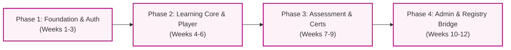

# Decoderium Academy: Project Proposal & Technical Specification
## Medical Doctor Learning Management System (LMS) & PMDC Certification Platform

> **Document Version**: 1.0.0  
> **Date**: 2026-11-06  
> **Project Code**: `STAND-HF-ACADEMY` / `DECODERIUM-ACADEMY`  
> **Ecosystem**: Education & Certification Companion to **Standhf.pk** (Heart Failure Clinical Registry)  
> **Target Framework**: ASP.NET Core 8 Web API + Blazor WebAssembly (`StandHF.Academy.*`)  
> **Reference Prototype**: Grounded in `ui-prototype/` (HTML5, CSS3, Vanilla JS, Pure Business Rules Engine)

---

## Executive Summary

**Decoderium Academy** is an accredited online medical education, continuing medical education (CME), and clinical certification platform developed specifically for physicians, cardiologists, and healthcare professionals within Pakistan and the broader cardiology community. Designed as the educational companion to the **Standhf.pk Heart Failure Clinical Registry**, the platform equips clinicians with guideline-directed medical therapy (GDMT) training, enforces strict video lecture completion thresholds, conducts server-timed randomized clinical evaluations, and awards cryptographically verifiable PMDC-linked certificates.

This proposal outlines the functional specifications, modular screen breakdown, role-based access rules, and business constraints governing the platform.

---

## Technical & Architectural Foundation

1. **Clean Architecture & Separation of Concerns**:
   - **Frontend Presentation Layer**: Interactive Blazor WebAssembly client mirroring the verified vanilla UI prototype (`ui-prototype/`), retaining the STAND-HF design system tokens (`var(--primary)` `#C90085`, `var(--card)`, `var(--ink)`, `var(--line)`).
   - **Shared Domain Rules (`StandHF.Academy.Shared/Rules`)**: Direct C# mirror of `ui-prototype/assets/rules.js` to guarantee identical business logic across client and server.
   - **Backend Application & Infrastructure**: ASP.NET Core 8 Web API backed by Entity Framework Core, SQL Server / PostgreSQL, and Redis cache.
2. **Deterministic Cryptographic Verification**:
   - High-performance, reproducible 32-bit FNV-1a hashing mechanism generating tamper-evident certificate codes formatted as `SHA-YYYY-XXXXXX`.
3. **Strict Compliance & Integrity Invariants**:
   - Zero-scrubbing client-side guard for unwatched video segments; server-side tracking of furthest watched seconds.
   - Server-authoritative quiz grading; correct answer keys are never transmitted to the client before grading.
   - Synchronized server countdown timers resilient to browser refreshes, disconnects, or local time tampering.

---

## Core System Modules

```
┌─────────────────────────────────────────────────────────────────────────────────────────┐
│                               DECODERIUM ACADEMY PLATFORM                                │
├──────────────────────────┬─────────────────────────────┬────────────────────────────────┤
│   Clinician Onboarding   │     Learning & Training     │   Assessment & Certification   │
│   - PMDC Verification    │     - Doctor Dashboard      │   - Timed 10-Min Quiz (MCQs)   │
│   - Role-Segregated Auth │     - Course Syllabus       │   - Cryptographic FNV-1a Certs │
│   - Registry Bridge      │     - 90% Threshold Player  │   - Public /verify Portal      │
├──────────────────────────┴─────────────────────────────┴────────────────────────────────┤
│                           GOVERNANCE & SYSTEM INFRASTRUCTURE                            │
│   - Admin Hub & Doctor Approvals    - Question Bank & Curriculum Builder                │
│   - Standhf.pk Ecosystem Switcher   - Audit Trails & Certificate Revocation             │
└─────────────────────────────────────────────────────────────────────────────────────────┘
```

---

### Module 1: Authentication & Onboarding

#### 1-Liner Core Summary
Secure credentialing gateway enforcing PMDC registration verification, role-segregated access (Doctor vs Admin), and hospital affiliation tracking.

#### Component & Screen Breakdown

| Component / Screen | Description | Target Role | Key Rule / Constraint |
| :--- | :--- | :--- | :--- |
| **Role-Segregated Sign-In** (`/login`) | Dual-tab authentication interface providing discrete entry channels for practicing medical doctors and administrative staff. | Doctor, Administrator | Session authenticated via secure HTTP-only JWT cookies; route guards (`requireRole`) automatically intercept and redirect unauthenticated requests. |
| **Doctor Registration & Onboarding** | Self-service registration portal capturing Full Name, Email, PMDC License Number, Clinical Speciality, Primary Hospital, City, and Phone. | Prospective Doctor | PMDC ID format validated via regex (e.g., `^\d{4,6}-[P,A-Z]$`); prevents duplicate registration on Email or PMDC ID; creates profile in `pending` approval state. |
| **PMDC License Verification Service** | Administrative and automated credential check validating the physician against the official PMDC medical registry. | Administrator, System | Doctors cannot take accredited module quizzes or earn official CME certificates until PMDC status is validated (`verified: true`). |
| **Account Recovery & Password Reset** | Secure token-based recovery workflow delivering one-time time-limited links to verified doctor email addresses. | Doctor, Administrator | Reset tokens expire within 15 minutes; single-use only; invalidates all active sessions upon successful credential reset. |
| **Demo Persona Quick-Switch** (Staging/Prototype Only) | One-click persona switcher (`ayesha.khan` mid-course, `bilal.ahmed` cert-ready, `admin`) for rapid client evaluation. | Evaluator, QA, Reviewer | Restricted strictly to non-production environments; pre-populates deterministic educational progress without database writes. |

---

### Module 2: Doctor Dashboard

#### 1-Liner Core Summary
Centralized clinician learning workspace delivering instant progress tracking, one-click lecture resumption, and chronological educational milestones.

#### Component & Screen Breakdown

| Component / Screen | Description | Target Role | Key Rule / Constraint |
| :--- | :--- | :--- | :--- |
| **Clinician Profile Banner** (`/home`) | Header card displaying clinician's full name, PMDC license identifier, medical specialty, institutional affiliation, and quick logout. | Doctor | Dynamically populated from authenticated profile; displays real-time verification badge. |
| **Executive Learning KPIs** (`.kpis`) | High-impact metric widgets displaying Enrolled Courses, Completed Lectures, Passed Quizzes, and Earned Certificates. | Doctor | Computed dynamically via canonical formula: $\text{Progress} \% = \left\lfloor \frac{\text{Watched} + \text{Quizzes}}{\text{Total Lectures} + \text{Total Modules}} \times 100 \right\rceil$. |
| **"Continue Learning" Hero Card** | Dynamic action banner displaying the user's active in-flight course, next required lecture/quiz, and a 1-click resume trigger. | Doctor | Intelligently evaluates module progression state; routes directly to the next unwatched lecture or pending quiz; auto-hides if all courses are 100% complete. |
| **Enrolled Courses Grid** | Responsive card catalog of all enrolled courses displaying course category, level, module counts, and completion percentage bars. | Doctor | Active courses display visual progress; completed courses show direct link to certificate view; minimum touch target $44\text{px}$. |
| **Activity & Achievement Rail** | Chronological event feed recording learning milestones (e.g., "Passed Module 1 Quiz - 90%", "Watched Lecture: GDMT Pillars"). | Doctor | Read-only ledger populated from user progress events; timestamps formatted to user local time; immutable history. |

---

### Module 3: Course Curriculum & Syllabus

#### 1-Liner Core Summary
Structured medical curriculum navigation with sequential prerequisite progression, module status indicators, and course catalog discovery.

#### Component & Screen Breakdown

| Component / Screen | Description | Target Role | Key Rule / Constraint |
| :--- | :--- | :--- | :--- |
| **Course Catalog & Discovery** (`/courses`) | Filterable directory of accredited cardiovascular courses (e.g. HFrEF Essentials, Heart Failure in Primary Care). | Doctor, Administrator | Courses flagged with `published: false` render as "Coming Soon" with disabled enrollment; filterable by clinical level and category. |
| **Course Overview Header** (`/courses#<id>`) | Course syllabus header showcasing title, clinical summary, lead faculty, CME credit allocation, and total runtime. | Doctor | Displays aggregate course progress bar; renders dynamic "Start Course" or "Resume Learning" primary CTA button. |
| **Sequential Module Stepper** | Visual learning path organizing modules sequentially ($M_1 \rightarrow M_2 \rightarrow M_3 \rightarrow M_4$) with prerequisites. | Doctor | Strict state progression: Module $N$ is `locked` until Module $N-1$ quiz is `passed`; Module 1 starts unlocked in `progress`. |
| **Module State Indicators** | State badge system categorizing units into `locked`, `progress`, `quiz ready`, or `passed`. | Doctor | Governed by pure rules engine (`RULES.moduleState`); prevents direct URL navigation to locked modules or premature quizzes. |
| **Lecture Item Drilldown** | Expandable lecture rows detailing title, presenter name, runtime in minutes/seconds, and clinical summary notes. | Doctor | Displays discrete watch status (`completed` if $\ge 90\%$ watched, `in-progress`, or `unwatched`); clicking routes to the Video Player. |

---

### Module 4: Video Learning Player

#### 1-Liner Core Summary
High-fidelity clinical lecture player enforcing strict watch compliance, scrub restriction, and integrated curricular navigation.

#### Component & Screen Breakdown

| Component / Screen | Description | Target Role | Key Rule / Constraint |
| :--- | :--- | :--- | :--- |
| **Clinical Lecture Viewport** (`/lecture/?id=...`) | Responsive video playback window (16:9) featuring playback/pause, volume control, fullscreen, and elapsed timer display. | Doctor | Built with mobile-responsive design tokens; preserves $44\text{px}$ minimum tap targets on all interactive elements. |
| **90% Watch Compliance Engine** | Background progress tracker logging playback progress and enforcing the mandatory completion threshold. | Doctor | Lecture marked `completed` if and only if watched seconds $\ge \lceil \text{duration} \times 0.90 \rceil$ (`RULES.lectureComplete`); updates saved via `recordWatch()`. |
| **Anti-Scrubbing Forward Barrier** | Playback seeker control preventing clinicians from skipping forward past their furthest continuously watched timestamp. | Doctor | Forward scrubbing beyond `furthestWatched` is blocked; rewinding and re-watching earlier segments is completely unconstrained. |
| **Demo Speed Accelerator** (Prototype / Staging Only) | Optional 30x accelerated playback simulation toggle for auditors, internal reviewers, and regression testing. | Evaluator, Reviewer | Active exclusively in test/demo mode; completely stripped from production video streaming pipelines. |
| **Curricular Contents Drawer & Next Step CTA** | Collapsible lecture drawer showing module progress and an automated "Proceed to Next Lecture / Take Quiz" button. | Doctor | Auto-activates upon reaching the 90% watch threshold; transitions seamlessly to the next sequential lecture or module quiz. |

---

### Module 5: Timed Module Quiz

#### 1-Liner Core Summary
Rigorous, server-timed clinical knowledge evaluations featuring randomized question banks, strict countdowns, and immediate remediation feedback.

#### Component & Screen Breakdown

| Component / Screen | Description | Target Role | Key Rule / Constraint |
| :--- | :--- | :--- | :--- |
| **Quiz Pre-Flight Briefing** (`/quiz/?m=...`) | Pre-test instruction view detailing 10 MCQ question count, 10:00 minute countdown, 70% passing grade, and attempt policies. | Doctor | Blocked until 100% of the current module's lectures meet the 90% watch threshold; displays historical scores if repeating. |
| **Timed Assessment Interface** | Focus-mode examination runner presenting 1 question at a time with clear answer selectors and quick-jump navigation matrix. | Doctor | Enforces a strict 10-minute (600s) countdown timer; active timer persists across page refreshes; auto-submits on timeout (00:00). |
| **Question Randomization & Option Shuffling** | Dynamic question engine drawing 10 MCQs from the module question pool and randomizing response choices. | Doctor | Questions selected randomly without replacement; choices shuffled per attempt using deterministic PRNG to prevent pattern memorization. |
| **Server-Side Grading Engine** | Server-authoritative scoring endpoint calculating percentage grade, evaluating pass/fail status, and logging attempts. | System, Doctor | Pass mark $\ge 70\%$ (7/10) inclusive; unanswered questions scored as incorrect (0); correct answer keys never exposed to client beforehand. |
| **Remediation & Review Breakdown** | Post-submission review screen highlighting score, pass/fail status, question-by-question explanations, and clinical guidance. | Doctor | Failed attempts enforce review before retrying (max attempts configurable, default 3); passing attempts unlock the next module immediately. |

---

### Module 6: Certificates & Credentialing

#### 1-Liner Core Summary
Tamper-resistant, verifiable medical credentials featuring cryptographic verification hashes, print-ready A4 layout, and public registry validation.

#### Component & Screen Breakdown

| Component / Screen | Description | Target Role | Key Rule / Constraint |
| :--- | :--- | :--- | :--- |
| **Certificate Gallery & Viewer** (`/certificates`, `#<id>`) | High-resolution digital certificate preview displaying Doctor Name, PMDC ID, Course Title, Completion Date, and Signatures. | Doctor | Available only upon 100% course completion (all lectures $\ge 90\%$ watched and all module quizzes passed, `RULES.courseComplete`). |
| **FNV-1a Cryptographic Code Engine** | Deterministic certificate code generation engine producing standardized codes: `SHA-YYYY-XXXXXX`. | System | Generated via 32-bit FNV-1a hash over `doctorId|courseId|YYYYMMDD`; verifiable across both JavaScript and C# backends. |
| **Print-Optimized A4 Landscape View** | Dedicated print stylesheet formatting the certificate for borderless A4 landscape output directly from browser dialog. | Doctor | Hides navigation bars, headers, buttons, and footers; forces crisp vector typography and high-DPI institutional branding. |
| **Vector PDF Export Service** | Server-side PDF generation pipeline providing pixel-perfect, downloadable vector certificate documents. | Doctor | Embeds vector typography, PMDC license number, official issuing signatures, and a scannable QR code resolving to the verification portal. |
| **Public Certificate Verification** (`/verify/?cert=...`) | Publicly accessible portal allowing hospitals, healthcare employers, and PMDC auditors to verify certificate legitimacy. | Public, PMDC Auditor | Zero authentication required; accepts certificate hash or serial code; displays doctor name, PMDC ID, course title, and issue date. |

---

### Module 7: Administration & Governance

#### 1-Liner Core Summary
Comprehensive administrative command center providing doctor identity management, curriculum authoring, assessment controls, and regulatory audit trails.

#### Component & Screen Breakdown

| Component / Screen | Description | Target Role | Key Rule / Constraint |
| :--- | :--- | :--- | :--- |
| **Admin Overview & Telemetry Hub** (`/admin#overview`) | Executive dashboard aggregating total registered doctors, course completion velocities, active quiz sessions, and cert volumes. | Administrator | Guarded by `requireRole('admin')`; renders high-level KPI cards and cohort completion charts. |
| **Doctor Directory & Verification** (`/admin#doctors`) | Searchable, paginated doctor table detailing PMDC ID, institutional affiliation, join date, and active/inactive status toggle. | Administrator | Capability to review pending registrations, toggle account activation (`setDoctorActive`), and manually verify PMDC credentials. |
| **Curriculum & Course Builder** (`/admin#courses`) | Administrative authoring suite to create courses, structure modules, configure video durations, and toggle publishing state. | Administrator | Toggling `published: false` immediately hides course from public catalog; deleting active modules with student progress is blocked. |
| **Question Bank & Scoring Management** | Management console for module question pools, question offsets, correct answer definitions, and passing thresholds. | Administrator | Each module requires a minimum pool size (default 10); changing active pass marks preserves historical certification validity. |
| **Certificate Audit & Revocation Console** | Compliance ledger tracking all issued certificates with instant search by hash/PMDC ID and revocation controls. | Administrator | Revoking a certificate immediately renders it "Invalid / Revoked" on the `/verify` portal; actions logged in permanent audit log. |

---

### Module 8: Clinical Registry Bridge (Standhf.pk)

#### 1-Liner Core Summary
Seamless cross-ecosystem navigation connecting the educational academy with the active STAND-HF Heart Failure Clinical Registry.

#### Component & Screen Breakdown

| Component / Screen | Description | Target Role | Key Rule / Constraint |
| :--- | :--- | :--- | :--- |
| **Ecosystem App Switcher** | Global top-bar switcher widget allowing clinicians to toggle between Decoderium Academy and the Standhf.pk Registry. | Doctor, Administrator | Preserves active user session across platform navigation; consistent top-bar styling across both products. |
| **Single Sign-On (SSO) & Identity Sync** | Federated identity bridge linking clinician profiles and PMDC IDs between the Academy and Clinical Registry databases. | Doctor | Authenticated Registry investigators access Academy with single credentials; eliminates redundant onboarding friction. |
| **Clinical Competency Linking** | Cross-platform verification linking Academy course certifications to Clinical Registry investigator privileges. | Doctor, Administrator | Registry can query Academy verification endpoint (`/api/certificates/{code}`) to verify GDMT training before authorising trial case logging. |
| **Shared Design System & Brand Identity** | Harmonized UI tokens (`assets/base.css`, `#C90085` magenta brand color, Roboto typography, $44\text{px}$ touch targets). | All Users | Absolute visual coherence across the entire STAND-HF / Decoderium digital health ecosystem. |

---

## Data Model & Entity Relationship Overview

```
┌──────────────────────┐          ┌──────────────────────┐          ┌──────────────────────┐
│        Doctor        │          │        Course        │          │     Certificate      │
├──────────────────────┤          ├──────────────────────┤          ├──────────────────────┤
│ Id (PK)              │          │ Id (PK)              │          │ Code (PK: FNV-1a)    │
│ FullName             │          │ Title                │          │ DoctorId (FK)        │
│ Email                │          │ Category / Level     │          │ CourseId (FK)        │
│ PmdcId (Unique)      │          │ Published (Bool)     │          │ IssueDate            │
│ Speciality           │          └──────────┬───────────┘          │ Revoked (Bool)       │
│ Hospital             │                     │ 1                    └──────────────────────┘
│ City / Phone         │                     ▼ *                               ▲ 1
│ IsActive / Verified  │          ┌──────────────────────┐                     │
└──────────┬───────────┘          │        Module        │                     │
           │ 1                    ├──────────────────────┤                     │
           │                      │ Id (PK)              │                     │
           │                      │ CourseId (FK)        │                     │
           │                      │ Title / Summary      │                     │
           │                      │ QuestionOffset / Pool│                     │
           │                      └──────────┬───────────┘                     │
           ▼ *                               │ 1                               │
┌──────────────────────┐                     ▼ *                               │
│    DoctorProgress    │          ┌──────────────────────┐                     │
├──────────────────────┤          │       Lecture        │                     │
│ DoctorId (PK, FK)    │          ├──────────────────────┤                     │
│ CourseId (PK, FK)    │          │ Id (PK)              │                     │
│ WatchedLectures []   │          │ ModuleId (FK)        │                     │
│ PassedQuizzes []     │          │ Title / Presenter    │                     │
│ Completed (Bool)     ├──────────┴──────────────────────┴─────────────────────┘
└──────────────────────┘
```

---

## Verification & Business Rules Matrix

| Rule Identifier | Specification | Reference Implementation | Error / Guard Behavior |
| :--- | :--- | :--- | :--- |
| **BR-01: Lecture Watch** | Complete when watched seconds $\ge \lceil \text{duration} \times 0.90 \rceil$. | `RULES.lectureComplete(lecture, watchedSeconds)` | Seeking past furthest reached timestamp blocked; lecture progress cannot regress. |
| **BR-02: Module Unlocking** | Module $N$ unlocks when Module $N-1$ quiz is passed; Module 1 open by default. | `RULES.moduleState(module, progress, course)` | Accessing locked module lecture or quiz redirects to active module stepper. |
| **BR-03: Quiz Eligibility** | Quiz opens only when all lectures in the module are $\ge 90\%$ watched. | `RULES.moduleState() === 'quiz'` | Direct URL access to `/quiz/?m=...` before all lectures are watched is rejected. |
| **BR-04: Quiz Grading** | 10 MCQs, 10 minutes, pass mark $\ge 70\%$ inclusive (7/10). | `RULES.scoreQuiz(questions, answers, passMark)` | Unanswered questions score as 0; server calculates score; answers hidden until submit. |
| **BR-05: Cert Generation** | Issued when all course modules are passed; deterministic code `SHA-YYYY-XXXXXX`. | `RULES.certCode(doctorId, courseId, dateStr)` | FNV-1a hash over `doctorId|courseId|YYYYMMDD`; verifiable across JS and .NET. |
| **BR-06: Public Verify** | Open unauthenticated lookup of certificate status by hash or serial code. | `access.verifyCert(code)` / `GET /api/certificates/{code}` | Returns valid verification payload or 404 "Certificate Not Found / Revoked". |

---

## Implementation & Phasing Roadmap



1. **Phase 1: Foundation & Identity (Weeks 1–3)**:
   - Database schema setup, PMDC validation service, ASP.NET Core 8 Web API scaffolding.
   - Doctor and Administrator role-segregated authentication, JWT cookie handlers, Blazor UI shell with STAND-HF design tokens.
2. **Phase 2: Curriculum & Video Learning Engine (Weeks 4–6)**:
   - Course catalog, module stepper state machine, and lecture content delivery.
   - Video player integration with anti-scrubbing controls and 90% watch threshold telemetry logging.
3. **Phase 3: Assessment, Scoring & Verification (Weeks 7–9)**:
   - Server-timed quiz engine, question bank shuffling, and automatic grading.
   - FNV-1a cryptographic certificate generator, A4 print layout, vector PDF export, and public `/verify` lookup.
4. **Phase 4: Governance & Ecosystem Integration (Weeks 10–12)**:
   - Administrative telemetry, doctor approval workflows, curriculum authoring, and certificate revocation.
   - Standhf.pk Clinical Registry single-sign-on (SSO) bridge and cross-system competency verification.
   - Comprehensive end-to-end clinical acceptance testing and PMDC audit review.
